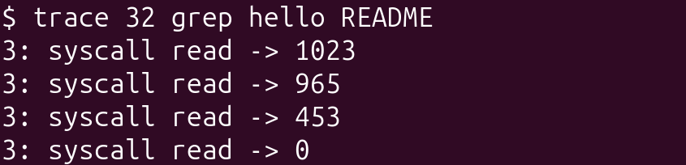
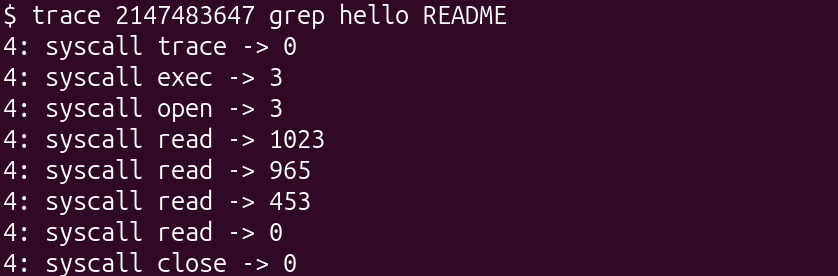
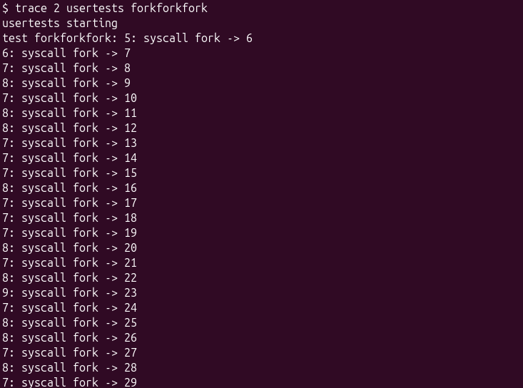
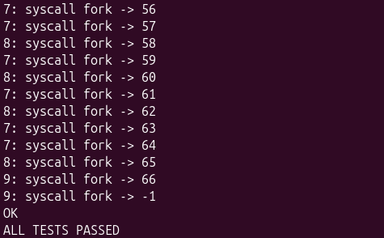
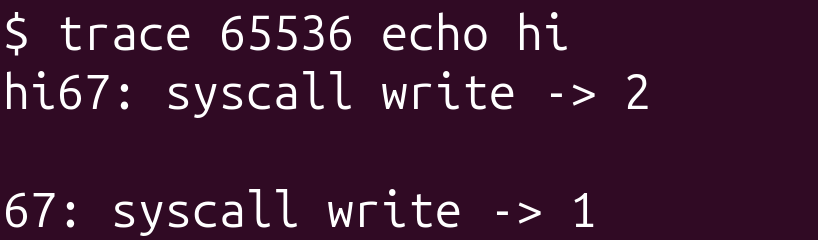

# Operating Systems: Laboratory Work No. 10

**Add Your Own System Call: trace** (Track B: Build Your Own Small OS, xv6)

**Elaborated by:** Veacheslav Morari, FAF-243
**Verified by:** Patricia Reţman

---

## Contents

- [Introduction](#introduction)
- [1. The number and the user side](#1-the-number-and-the-user-side)
- [2. The kernel side](#2-the-kernel-side)
- [3. Play with the mask](#3-play-with-the-mask)
- [Conclusion](#conclusion)

---

## Introduction

For the first time in this course I change the kernel itself. The purpose of this laboratory work is to add a new system call to xv6, called `trace`, which makes a process print every system call it makes. On Linux, `strace` did this for me in Lab 9; here I build the same mechanism from scratch. One number, 23, is followed from a user program all the way down into a function inside the kernel. The complete diff of the changes is in `trace.patch`; the new user program is in `trace.c`.

## 1. The number and the user side

The first part gives the new call a number and lets a user program ask for it. Five small edits.

**1.1 kernel/syscall.h — the number.** A new line was added at the end:

```c
#define SYS_sync   22
#define SYS_trace        23       // new
```

**1.2 user/user.h — the declaration.**

```c
int sync(void);
int trace(int);                // new
```

**1.3 user/usys.pl — the stub that runs ecall.** At build time this script writes `user/usys.S`, where `trace` becomes three instructions: `li a7, SYS_trace`; `ecall`; `ret`.

```perl
entry("sync");
entry("trace");                # new
```

**1.4 user/trace.c — the program.** The complete source is included alongside this report.

```c
#include "kernel/types.h"
#include "kernel/stat.h"
#include "user/user.h"

int
main(int argc, char *argv[])
{
  if (argc < 3) {
    fprintf(2, "usage: trace mask command [args...]\n");
    exit(1);
  }
  if (trace(atoi(argv[1])) < 0) {
    fprintf(2, "trace: failed\n");
    exit(1);
  }
  exec(argv[2], argv + 2);
  fprintf(2, "trace: exec %s failed\n", argv[2]);
  exit(1);
}
```

The program sets the mask on itself, then calls `exec` on the command. The mask stays in the kernel's `struct proc` because `exec` keeps the process, only replacing its code.

**1.5 Makefile — put `trace` on the xv6 disk.** The line `$U/_trace\` was added to `UPROGS`.

**Check 1.** `make qemu`, then inside xv6:

```
$ trace 32 grep hello README
3 trace: unknown sys call 23
trace: failed
```

The error *is* the sign of success: the user program ran `ecall` with `a7 = 23`, the kernel received the request, and complained only because the number was not yet in the dispatch table.

## 2. The kernel side

The second part gives the number a function and makes the kernel print every call when the current process has a non-zero mask.

**2.1 kernel/proc.h — a place for the mask.** Each process gets its own trace mask, stored in `struct proc` after the name:

```c
char name[16];               // Process name (debugging)
int trace_mask;              // new: which calls to print
```

**2.2 kernel/sysproc.c — the handler.** The function reads argument 0 (register `a0`) and saves it in the process's `trace_mask`:

```c
uint64
sys_trace(void)
{
  int mask;
  argint(0, &mask);
  myproc()->trace_mask = mask;
  return 0;
}
```

**2.3 kernel/syscall.c — the table.** Two lines connect the number to the function:

```c
extern uint64 sys_trace(void);          // new
...
[SYS_trace]   = sys_trace,              // new
```

**2.4 kernel/syscall.c — names and print.** A new table of names was added above the `syscall()` function, and two lines were inserted right after the dispatch call. The kernel prints the trace line *after* the call, so the return value is already in `a0`:

```c
static char *syscallnames[] = {
   [SYS_fork] "fork",   [SYS_exit] "exit",     [SYS_wait] "wait",
   [SYS_pipe] "pipe",   [SYS_read] "read",     [SYS_kill] "kill",
   [SYS_exec] "exec",   [SYS_fstat] "fstat",   [SYS_chdir] "chdir",
   [SYS_dup] "dup",     [SYS_getpid] "getpid", [SYS_sbrk] "sbrk",
   [SYS_pause] "pause", [SYS_uptime] "uptime", [SYS_open] "open",
   [SYS_write] "write", [SYS_mknod] "mknod",   [SYS_unlink] "unlink",
   [SYS_link] "link",   [SYS_mkdir] "mkdir",   [SYS_close] "close",
   [SYS_sync] "sync",   [SYS_trace] "trace",
};

// inside syscall():
p->trapframe->a0 = syscalls[num]();
if ((p->trace_mask >> num) & 1)                    // new
  printk("%d: syscall %s -> %ld\n",                // new
         p->pid, syscallnames[num], p->trapframe->a0);
```

**2.5 kernel/proc.c — children inherit the mask.** In `fork()`, right after the name copy:

```c
safestrcpy(np->name, p->name, sizeof(p->name));
np->trace_mask = p->trace_mask;      // new
```

This single line is critical: without it only the original `trace` process would print, and `trace 2 usertests forkforkfork` would see no fork trace, because every fork would produce a child with `trace_mask = 0`.

**Check 2.** After rebuilding, `trace 32 grep hello README` now prints the four reads of `README` (Figure 1.1).



*Figure 1.1 — Check 2: `trace 32 grep hello README` inside xv6. Mask 32 = 2⁵ enables bit 5 = SYS_read, so the kernel prints every `read`. The numbers 1023 + 965 + 453 = 2441, the size of README, read in three chunks followed by 0 (EOF).*

## 3. Play with the mask

The mask is a number read in binary: bit N set means "print call number N".

### 3.1. All the calls, mask = 2³¹ - 1

```
$ trace 2147483647 grep hello README
```

With every bit enabled (Figure 2.1) the whole life of `grep` is visible: `trace` itself returning 0, `exec` returning 3, `open` returning 3 (the first free descriptor), four `read`s with the same lengths as before, and a `close` returning 0 at the end.



*Figure 2.1 — All system calls of `grep hello README` traced at once.*

### 3.2. Only fork, mask = 2, with usertests forkforkfork

```
$ trace 2 usertests forkforkfork
```



*Figure 3.1 — Start of `forkforkfork` traced with mask 2. Several different PIDs (5, 6, 7, 8, 9, ...) print trace lines, because every child inherits the mask through the line we added in `fork()`.*



*Figure 3.2 — End of the same run: `fork -> -1` means the process table is full, after which the test finishes with `ALL TESTS PASSED`.*

### 3.3. Only write, mask = 65536, with echo hi

```
$ trace 65536 echo hi
hi67: syscall write -> 2
67: syscall write -> 1
```

Figure 4.1 shows the output: the trace line for the first `write` is printed *between* `hi` and the newline, because `echo` calls `write` twice — once for the two bytes of `hi`, once for the newline — and the kernel prints each trace line after the syscall returns, so the first one lands right after the two characters, before the newline is sent.



*Figure 4.1 — `trace 65536 echo hi`: two `write` calls from `echo`, for 2 bytes and 1 byte.*

### 3.4. Observations

**Why only `read` appears for `trace 32 grep hello README`.** 32 in binary is `100000`, i.e. only bit 5 is set, and bit 5 corresponds to `SYS_read`. Every other call (`trace`, `exec`, `open`, `close`) is made by `grep`, but their bits are 0 in the mask, so the kernel's check `(p->trace_mask >> num) & 1` is false and nothing is printed.

**Why many different pids print lines in forkforkfork.** The line `np->trace_mask = p->trace_mask;` in `fork()` is what makes it possible: the child inherits the mask from the parent, so every descendant of the first traced process is also traced. Without that one line, only the original process would print, and the test would show a single line instead of dozens.

**Why the trace line is between "hi" and the newline.** `echo` calls `write` twice. The first call is `write(1, "hi", 2)`, which prints `hi` to the terminal. After the call returns, the kernel sees that bit 16 is set in the mask and prints the trace line. Then `echo` calls `write(1, "\n", 1)`, which sends the newline; the kernel prints the second trace line after that.

**Which mask traces `open` (15) and `close` (21) only.** The mask with those two bits set is 2¹⁵ + 2²¹ = 32768 + 2097152 = **2129920**, in binary `1000000001000000000000`.

## Conclusion

Adding `trace` to xv6 followed the number 23 from `syscall.h` through the user-side stub generated by `usys.pl`, into `sys_trace` in `sysproc.c`, and through the dispatch table and the print loop in `syscall.c`. The small helper field `trace_mask` in `struct proc` made the state per-process, and the single line in `fork()` let children inherit it. The experiments in Part 3 verified every part of the design: a specific mask limits the trace to one call, the inheritance line is responsible for seeing many different PIDs under `forkforkfork`, and the position of the trace line in `echo hi` matches the number of `write` calls that `echo` makes. I have now written my first kernel code that other programs can use, and I can see how the same mechanism underlies `strace` on Linux.
