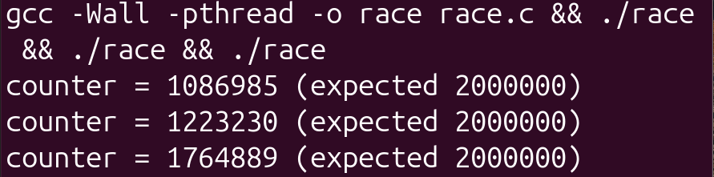
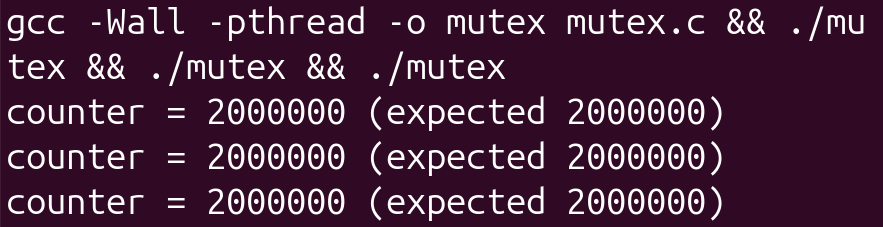
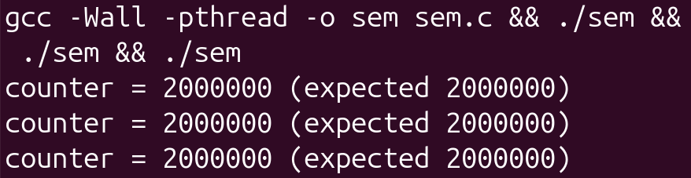
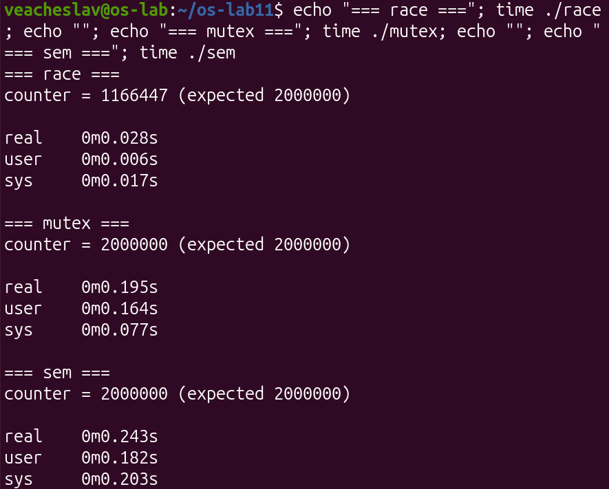
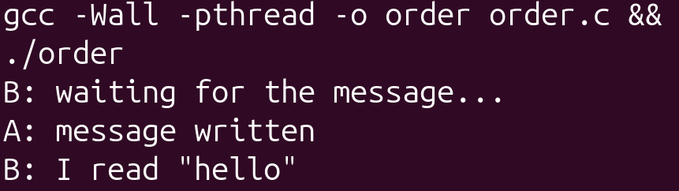
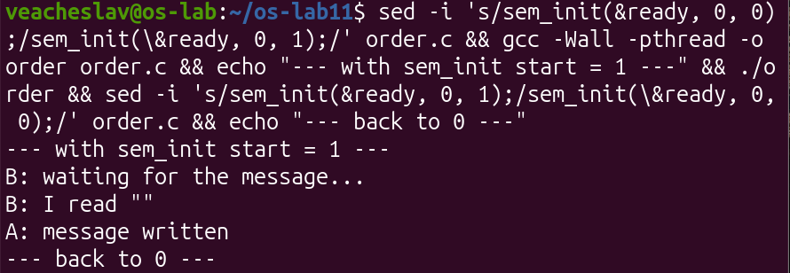
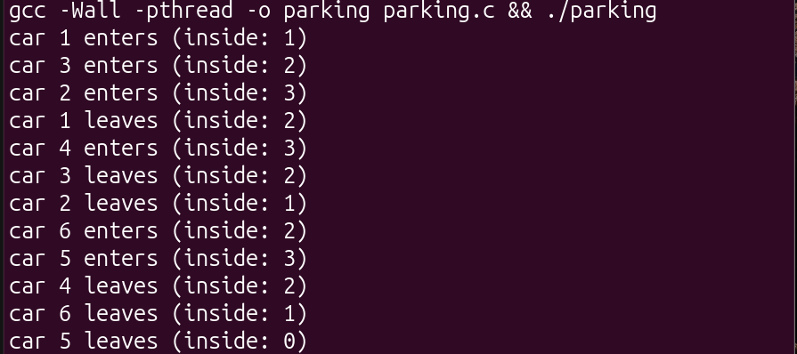

# Operating Systems: Laboratory Work No. 11

**Introduction to Threads and Semaphores** (Track A: The Real OS, from the Outside, Linux)

**Elaborated by:** Veacheslav Morari, FAF-243
**Verified by:** Patricia Reţman

---

## Contents

- [Introduction](#introduction)
- [1. The race](#1-the-race)
- [2. Two ways to stop the race](#2-two-ways-to-stop-the-race)
- [3. The semaphore as a signal](#3-the-semaphore-as-a-signal)
- [4. The semaphore as a resource counter](#4-the-semaphore-as-a-resource-counter)
- [Conclusion](#conclusion)

---

## Introduction

The previous laboratory works put programs next to each other but never really let them share memory. Threads change that: two threads of the same process read and write the same variables at the same time, and almost nothing about the C language prepares a beginner for what happens next. The purpose of this laboratory work is to see the race condition with my own eyes, to fix it twice — once with a mutex, once with a binary semaphore — and then to use a counting semaphore for two different jobs that a mutex cannot do: imposing an order between two threads and limiting a shared resource. The work was done on Ubuntu 26.04 with `gcc` and `pthreads`, the five programs are `race.c`, `mutex.c`, `sem.c`, `order.c` and `parking.c`.

## 1. The race

The first program, `race.c`, starts two threads that each increment a shared counter `N = 1 000 000` times. The expected final value is 2·N = 2 000 000. The program was compiled without optimisation so the race is clearly visible:

```
$ gcc -Wall -pthread -O0 -o race race.c
$ ./race
counter = 1086985   (expected 2000000)
$ ./race
counter = 1223230   (expected 2000000)
$ ./race
counter = 1764889   (expected 2000000)
```

Figure 1.1 captures one of the runs.



*Figure 1.1 — `./race` printed 1 086 985 instead of 2 000 000. Almost half of the increments were lost.*

The reason is that `counter++` is not one machine instruction but three: load the current value from memory into a register, add one, store the register back to memory. If thread A loads 42, is preempted, thread B loads the same 42, adds one, writes 43, then A adds one to its old 42 and writes 43 again, one increment is silently lost. On two cores running at the same time the story is the same without any preemption. The lower the compiler optimisation and the simpler the loop body, the more preemptions happen inside the critical three-step sequence, and the worse the final count becomes.

## 2. Two ways to stop the race

The way to stop the race is to make the three steps happen with no interleaving. Two primitives do this: a mutex (`mutex.c`) and a binary semaphore (`sem.c`).

**2.1 Mutex.** `pthread_mutex_lock(&m)` blocks until no other thread owns the mutex, then takes ownership. `unlock` releases it. Only the owner can hold the lock at any instant, so the three steps of `counter++` cannot be interleaved by another thread. After rebuilding and running:

```
$ ./mutex
counter = 2000000   (expected 2000000)
```

Figure 2.1 shows the correct result.



*Figure 2.1 — With the mutex, the final count matches the expectation on every run.*

**2.2 Semaphore initialised to 1.** A semaphore with initial value 1 behaves exactly like a mutex: the first `sem_wait` decrements it from 1 to 0 and passes, a concurrent `sem_wait` blocks until the holder calls `sem_post`, which increments back to 1. `sem.c` uses this pattern:

```
$ ./sem
counter = 2000000   (expected 2000000)
```

Figure 2.2 shows the output.



*Figure 2.2 — Binary semaphore (initial value 1) used as a mutex gives the same correct count.*

**2.3 Cost comparison.** The three programs take wildly different time because two of them pay for a system call on every increment. Measured with `time`:



*Figure 2.3 — `time` for the three programs. The race finishes in a few milliseconds (it does nothing useful); `mutex` takes tens of milliseconds because `pthread_mutex_lock` fast-paths an atomic operation in userspace; `sem` is the slowest because every `sem_wait/post` can enter the kernel through `futex`.*

The mutex is the right tool for simple mutual exclusion because it is designed exactly for that one job and takes the fast path when there is no contention. The semaphore is slower because its counter and its wake-up machinery do more work than needed for a two-state lock. The right conclusion is not that one is "better" but that each has its purpose, and 2.4 and 2.5 show what the semaphore does that the mutex cannot.

## 3. The semaphore as a signal

`order.c` uses a semaphore for a job that mutexes do not do at all: forcing thread B to continue only after thread A has finished a specific step. The semaphore starts at 0. Thread B does `sem_wait(&ready)` and blocks immediately because the value is 0 (and blocking is not an error — it is the whole point). Thread A sleeps for a second, writes the shared buffer, prints its own line, and does `sem_post(&ready)`, which wakes B up. B reads the buffer *after* A wrote it:

```
B: waiting...
A: wrote 'hello'
B: read 'hello'
```

Figure 3.1 shows the sequence.



*Figure 3.1 — Normal run: B waits, A writes, B reads the message. The order is enforced by the semaphore.*

Changing the third argument of `sem_init` from 0 to 1 and rebuilding breaks the order: B passes `sem_wait` without blocking (the value is 1, it goes to 0 and the call returns), reads the buffer before A has written anything, and prints an empty string.



*Figure 3.2 — `sem_init(&ready, 0, 1)`: B does not wait and reads the empty buffer.*

This shows the semaphore in its "signal" role: it is a one-way message from A to B. No mutex can do this because a mutex has only two states, locked and unlocked, both symmetric, and it cannot start locked by a thread that is not even running yet.

## 4. The semaphore as a resource counter

The last program, `parking.c`, uses a semaphore for its third role: counting a bounded resource. Six cars (threads) want to park in a lot with three spaces. The semaphore `spaces` is initialised to 3 and counts the number of free places. Each car does `sem_wait(&spaces)` on arrival (take a space; block if none left), parks for one second, and `sem_post(&spaces)` on leaving (release the space). A small mutex protects a plain counter `inside` so that the printed value is always consistent.

Figure 4.1 shows a run.



*Figure 4.1 — 6 cars, 3 places. The first three park at once; cars 4, 5 and 6 wait until the earlier cars leave. The counter `inside` never exceeds 3.*

The property to notice is that `inside` is printed only inside the critical section protected by the mutex, and it is never more than 3 — the semaphore guarantees this before the mutex ever gets involved. The semaphore here is not a lock and not a signal: it is a budget. When the budget is exhausted (`spaces == 0`), the next `sem_wait` blocks; when some other thread releases, one of the waiters wakes up and proceeds.

## Conclusion

The experiments showed three faces of the same primitive. A race condition between two threads is not a rare bug but the default outcome of unprotected shared state: half of the increments were silently dropped. A mutex and a binary semaphore both close the race by serialising the critical section, but they do so with slightly different cost and intent — the mutex is the standard tool for mutual exclusion, cheaper because it does less. A counting semaphore does two more things no mutex can: it imposes an order between threads by starting at 0 and being posted by the thread that finishes first, and it limits a shared resource by starting at the capacity and tracking the number of free units. All three programs that use semaphores shared one line: `sem_init(&s, 0, N)` — the number `N` on the right turned the same primitive into a mutex (`N = 1`), a signal (`N = 0`) or a counter (`N = capacity`). This flexibility is why semaphores remain a core synchronisation primitive thirty years after their introduction, and why the next laboratory work reaches for them again when more subtle ordering is needed.
