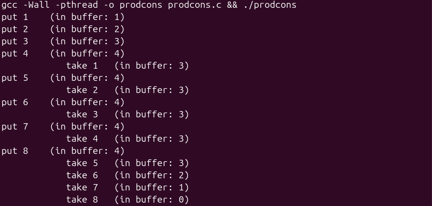
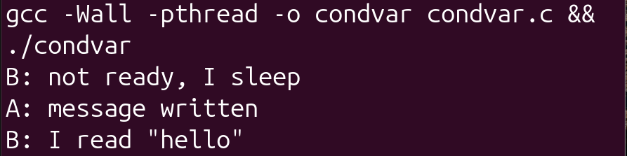
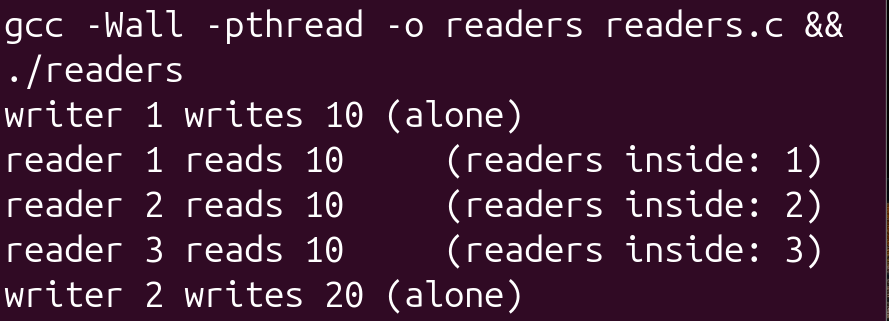
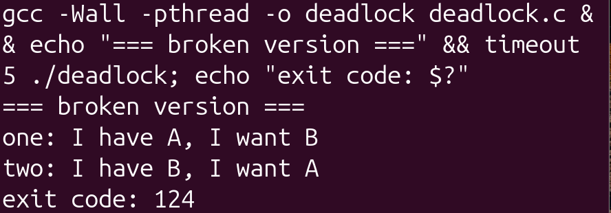
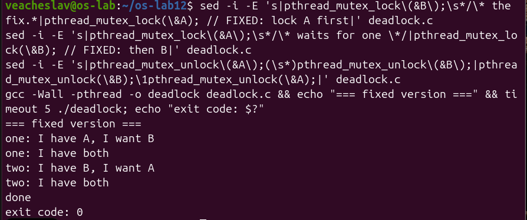

# Operating Systems: Laboratory Work No. 12

**Synchronisation Patterns: Producer–Consumer, Condition Variables, Readers–Writers, Deadlock** (Track A: The Real OS, from the Outside, Linux)

**Elaborated by:** Veacheslav Morari, FAF-243
**Verified by:** Patricia Reţman

---

## Contents

- [Introduction](#introduction)
- [1. Producer and consumer](#1-producer-and-consumer)
- [2. Condition variables](#2-condition-variables)
- [3. Readers and writers](#3-readers-and-writers)
- [4. Deadlock and its fix](#4-deadlock-and-its-fix)
- [Conclusion](#conclusion)

---

## Introduction

Lab 11 showed one primitive (the semaphore) in three roles: mutex, signal and counter. This laboratory work combines those roles to build the classical patterns of concurrent programming: a bounded buffer shared between a producer and a consumer, a condition variable to wait for a predicate on shared state, the reader / writer protocol that lets many readers share data but gives writers exclusive access, and finally the textbook deadlock that teaches *why* the order in which locks are taken is a property of the whole program, not of a single thread. The four programs are `prodcons.c`, `condvar.c`, `readers.c` and `deadlock.c` (plus `deadlock_fixed.c`), all built on Ubuntu 26.04 with `gcc -pthread`.

## 1. Producer and consumer

`prodcons.c` has a ring buffer with `SIZE = 4` slots, one producer and one consumer, and three synchronisation primitives: two counting semaphores and one mutex. `empty` starts at `SIZE` and counts free slots; `full` starts at 0 and counts filled slots; `mutex` protects the ring indices `head` and `tail`. The producer does `sem_wait(&empty)` (take a free slot, block if none), fills the slot under the mutex, and `sem_post(&full)` (announce a new item). The consumer does the mirror: `sem_wait(&full)`, pull the item, `sem_post(&empty)`.

The producer sleeps 0.1 s between items and the consumer 0.3 s, so the producer runs ahead until the buffer fills to its capacity, 4. At that point the next `sem_wait(&empty)` blocks the producer until the consumer removes one item. Figure 1.1 captures this: the first four `put` lines fill the buffer to 4, then every `take` is followed by one `put` (buffer oscillates between 3 and 4), and once all 8 items have been produced the consumer drains the tail in rapid succession.

*Figure 1.1 — Producer-consumer with a buffer of 4. The producer blocks after `put 4`, then the consumer and producer alternate; once production stops, the consumer drains the buffer down to 0.*

### 1.1 Observations

Three primitives are needed and not two, because the three jobs are distinct. `empty` and `full` carry the two signals (free-slot-available and item-available) and are each used from one side only, so they never conflict. The mutex protects the ring buffer indices, which are shared read-write by both threads. Collapsing any two of them loses a property: without the mutex, the two indices can move inconsistently; without `empty` the producer would overwrite slots that have not been consumed; without `full` the consumer would read from empty slots. Note that `empty` is waited on by the producer and posted by the consumer (and the reverse for `full`): the producer and consumer talk to each other through the semaphore values, not directly.

## 2. Condition variables

`condvar.c` solves the same ordering problem as `order.c` from Lab 11 (B reads *after* A writes) but with a condition variable instead of a signal semaphore. A condition variable always goes with a mutex. Thread B holds the mutex, checks the predicate `ready` and, if the predicate is false, calls `pthread_cond_wait(&cv, &m)`. That call atomically releases the mutex and goes to sleep. Thread A locks the mutex, sets the predicate, calls `pthread_cond_signal(&cv)` and releases the mutex; B wakes up, reacquires the mutex, rechecks the predicate and continues.

Figure 2.1 shows the run:

*Figure 2.1 — B prints "not ready, I sleep", A later prints "message written", B wakes up and reads the message.*

### 2.1 Observations

Two details decide whether a condition-variable program is correct. First, the predicate check is `while (!ready)` and not `if (!ready)`. `pthread_cond_wait` is allowed to return without a matching signal (a *spurious wakeup*) and it will if another thread wakes several waiters at once; the `while` loop sends the thread back to sleep in that case. Second, the mutex must be held both when checking the predicate *and* when setting it, otherwise B can observe the predicate as false, A can set it and signal, and B can go to sleep without noticing — a classic "lost wakeup". A signal semaphore does not have the spurious-wakeup problem because its value is a stored, counted thing; the condition variable trades that for the ability to wait for any predicate, not just "a thing happened once".

## 3. Readers and writers

`readers.c` implements the reader-preference variant of the readers / writers problem. The protocol is: many readers may hold the data at the same time (they do not modify it, so there is no race), but a writer must hold it alone. Two primitives are used. `rlock` is an ordinary mutex that protects the integer counter `rcount` (number of readers currently inside). `wlock` is a binary semaphore that admits either one writer or the whole reader group. The first reader does `sem_wait(&wlock)` (locks writers out) and the last reader does `sem_post(&wlock)` (lets a waiting writer in); intermediate readers just bump the counter under `rlock`.

The test timing (`sleep` between thread creations) was chosen so that writer 1 arrives first, then three readers arrive while writer 1 still works, and writer 2 arrives only after all readers are gone.

*Figure 3.1 — writer 1 alone, three readers simultaneously (readers inside: 1, 2, 3), writer 2 alone.*

### 3.1 Observations

The simultaneity of the three readers is the whole point: with a plain mutex instead of the "first reader locks, last reader unlocks" pattern, every reader would serialise and three readers would take three times as long for no reason. The pattern comes at a price: writers can starve. If new readers keep arriving faster than the last one leaves, `rcount` never reaches 0 and `wlock` is never posted, so any waiting writer never gets in. Writer-preference variants exist that solve this by keeping a `writer-is-waiting` flag or an extra semaphore; this program uses the simpler reader-preference form.

## 4. Deadlock and its fix

`deadlock.c` creates the textbook deadlock: two threads, two mutexes `A` and `B`, taken in opposite orders.

- Thread `one` locks `A`, sleeps 1 second, then asks for `B`.
- Thread `two` locks `B`, sleeps 1 second, then asks for `A`.

Because of the sleep, by the time each thread asks for its second mutex, the other thread is already holding it. Each waits for the other to let go, forever. The program is killed by `timeout 5 ./deadlock`, which sends SIGTERM after 5 seconds; the shell reports exit code 124.

*Figure 4.1 — Broken version: "one: I have A, I want B" and "two: I have B, I want A" print, nothing else, and `timeout` kills the program (`exit code: 124`).*

The fix is to ensure both threads take the mutexes in the same order — any order, as long as it is the same. Here both threads now lock `A` first, then `B`. The fixed program runs in about one second and prints the expected "done":

*Figure 4.2 — After applying lock ordering (both threads take A first, then B), the program completes with `exit code: 0`.*

### 4.1 Observations

Four conditions must all hold for a deadlock to occur (the classical Coffman conditions): mutual exclusion (resources cannot be shared — true for mutexes), hold-and-wait (a thread holding one resource asks for another), no preemption (the OS cannot pull a mutex away from its owner) and circular wait (a cycle in the "waits-for" graph). Breaking any one condition is enough; lock ordering breaks the circular wait because taking locks in a global order makes the "waits-for" graph a DAG, which cannot have cycles. Removing the `sleep(1)` would not fix the bug: the deadlock would just become non-deterministic, appearing randomly in production instead of always in testing. That is strictly worse — a bug you can reproduce is a bug you can fix.

## Conclusion

The four patterns of this laboratory work are small but general. Producer / consumer is how pipelined work flows between any two long-running threads; in Unix, every `|` in the shell is a bounded buffer with exactly this protocol in the kernel. Condition variables are the generalisation of the signal semaphore from Lab 11, trading simplicity for the ability to wait on any predicate at the cost of handling spurious wakeups. Readers / writers formalises the common case where multiple consumers share read-only data — the same pattern lives in the kernel as a read / write lock, and in every database as shared / exclusive locks. And the deadlock experiment showed that correctness in a concurrent program is a property of the whole set of lock-acquisition orders across the whole program, not of any single function — a global rule, such as "mutexes are always taken in the order of their address", is the usual way to enforce it. The next laboratory work brings these ideas into the kernel: xv6 gains its own `sem_init / sem_down / sem_up` syscalls built on `sleep_prepare` and `wakeup`.
