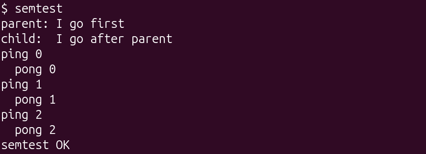
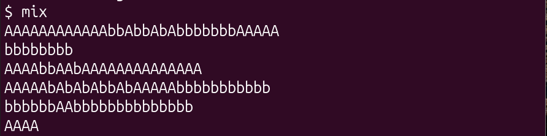
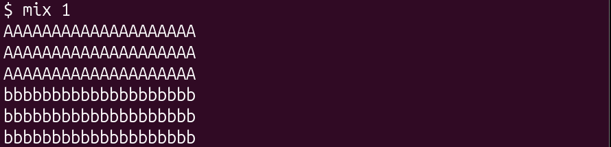

# Operating Systems: Laboratory Work No. 13

**Add Semaphores to xv6** (Track B: Build Your Own Small OS, xv6)

**Elaborated by:** Veacheslav Morari, FAF-243
**Verified by:** Patricia Reţman

---

## Contents

- [Introduction](#introduction)
- [1. The numbers, the stubs, the Makefile](#1-the-numbers-the-stubs-the-makefile)
- [2. The kernel side](#2-the-kernel-side)
- [3. Mutual exclusion in xv6](#3-mutual-exclusion-in-xv6)
- [Conclusion](#conclusion)

---

## Introduction

In Lab 10 I added one system call (`trace`) to xv6. In Lab 11 and 12 I used `sem_init / sem_wait / sem_post` from the Linux pthread library without ever thinking about what happens inside. This laboratory work closes the loop: three new xv6 system calls — `sem_init`, `sem_down`, `sem_up` — implemented from scratch, with a small table of eight semaphores inside the kernel and a user-side test that demonstrates the two classic uses: forcing an order between parent and child, and protecting a shared resource (the terminal) from interleaving. The complete diff is in `sem.patch`, the kernel implementation is in `kernel/sem.c`, and the two test programs are `user/semtest.c` and `user/mix.c`.

## 1. The numbers, the stubs, the Makefile

The first part is pure plumbing: give each new call a number, declare it on the user side, add the stub that performs `ecall`, and put the two test programs on the xv6 disk. Five files touched.

**1.1 kernel/syscall.h — three new numbers.** Lab 10 ended at 23, so the next free slots are 24, 25, 26:

```c
#define SYS_sem_init    24       // Lab 13
#define SYS_sem_down    25       // Lab 13
#define SYS_sem_up      26       // Lab 13
```

**1.2 user/user.h — the declarations.** Three prototypes after the existing `trace`:

```c
int sem_init(int, int);         // sem_init(idx, value)
int sem_down(int);              // P (wait)
int sem_up(int);                // V (signal)
```

**1.3 user/usys.pl — the ecall stubs.** At build time this Perl script writes `user/usys.S` containing `li a7, SYS_sem_init; ecall; ret` for each entry:

```perl
entry("sem_init");             # Lab 13
entry("sem_down");             # Lab 13
entry("sem_up");               # Lab 13
```

**1.4 Makefile.** Two edits: the kernel object `$K/sem.o` is added to the `OBJS` list, and the two user programs `_semtest` and `_mix` are added to `UPROGS` so that `mkfs` places them on the xv6 filesystem image.

**Check 1.** Before touching the kernel side, running `semtest` from the xv6 shell gives the expected error:

```
$ semtest
3 semtest: unknown sys call 24
sem_init(0) failed
```

The number 3 is the pid of `semtest`, and "unknown sys call 24" is printed by the dispatcher because `syscalls[24]` is `NULL`. That is the proof that the user side works: the stub fired `ecall` with `a7 = 24`, the kernel caught it, and refused only because the dispatch table has no entry for that number yet. The user-side plumbing is complete.

## 2. The kernel side

The second part adds the three handlers and the dispatch-table entries. The core of the work is the new file `kernel/sem.c`.

**2.1 kernel/sem.c — the table and three handlers.** Inside the kernel, the eight semaphores live in a small static table, each with a `value`, a spinlock to protect that value, and an `inited` flag so uninitialised slots can be rejected. The spinlock is the serialisation primitive that guards the semaphore's own state — exactly the same role the pthread library's internal lock plays inside glibc.

```c
#define NSEM 8
struct {
  struct spinlock lock;
  int value;
  int inited;
} sem[NSEM];
```

**2.2 sys_sem_down — the P operation.** The handler reads the index from register `a0`, acquires the semaphore's spinlock, and runs the classic P loop:

```c
while (sem[idx].value <= 0) {
  sleep_prepare(&sem[idx]);     // register as waiter on channel
  release(&sem[idx].lock);      // let other threads run
  sleep();                      // actually block
  acquire(&sem[idx].lock);      // wake up and re-check
}
sem[idx].value--;
release(&sem[idx].lock);
```

Three details are worth stating explicitly. The check uses `while` and not `if`, because by the time `sleep()` returns another thread may have decremented the value before this thread re-acquires the lock. The `sleep_prepare / release / sleep` sequence is xv6's atomic sleep primitive: `sleep_prepare` registers the current process as waiting on a channel, then the spinlock is released, then `sleep()` actually sets the process to `SLEEPING` and yields. The ordering is important: if the spinlock were released before `sleep_prepare`, a concurrent `wakeup(&sem[idx])` could be missed (the "lost wakeup" problem). The address of the semaphore itself serves as the wait channel.

**2.3 sys_sem_up — the V operation.** The increment and the wake-up happen under the same spinlock:

```c
acquire(&sem[idx].lock);
sem[idx].value++;
wakeup(&sem[idx]);              // wake all threads waiting on this channel
release(&sem[idx].lock);
```

`wakeup` walks the process table and marks every process with `chan == &sem[idx]` as `RUNNABLE`. Only one of them will succeed on the next iteration of the P loop (the others see the value back at 0 and go back to sleep); this is a *thundering herd* and is acceptable here because the semaphore table is small and the wait lists are short. A production implementation would keep a per-semaphore wait queue and wake exactly one waiter.

**2.4 kernel/syscall.c — the dispatch table.** Three `extern` declarations and three table entries connect the numbers to the handlers. The syscall-names array is also extended so trace output names the calls:

```c
[SYS_sem_init] = sys_sem_init,
[SYS_sem_down] = sys_sem_down,
[SYS_sem_up]   = sys_sem_up,
```

**Check 2.** After rebuilding, `semtest` passes:



*Figure 2.1 — `semtest`: Part A forces the child to run after the parent via one semaphore starting at 0; Part B is a ping-pong of three exchanges via two semaphores (`sem[1]` starts at 1 for the parent's turn, `sem[2]` at 0 for the child's turn). The strict alternation `ping 0, pong 0, ping 1, pong 1, ping 2, pong 2` proves the two sides never both hold the "turn".*

In Part A, the child is forked almost immediately, but it blocks inside `sem_down(0)` because the semaphore starts at 0. The parent `pause(10)` gives the child enough time to go to sleep in the kernel, then the parent prints and calls `sem_up(0)`; the kernel's `wakeup` moves the child back to `RUNNABLE`, the child's `while (value <= 0)` sees the value at 1, decrements it and returns.

In Part B, two semaphores form an alternating lock: only one of parent and child holds the right to print at a time. The parent starts (because `sem[1]` is 1), prints "ping 0" and passes the turn to the child by posting `sem[2]`; the child, which was blocked on `sem_down(2)`, wakes, prints "pong 0" and posts `sem[1]`, passing back. Six exchanges, no interleaving.

## 3. Mutual exclusion in xv6

The third part shows that the same semaphore is a correct mutex for xv6 user processes. `user/mix.c` forks and then both parent and child each print three rows of twenty characters (the parent prints `A`, the child prints `b`). Without any synchronisation, xv6's round-robin scheduler slices into the middle of the rows:



*Figure 3.1 — `mix` with no lock: every row contains a mix of A and b; the newlines of one process cut the output of the other at arbitrary positions.*

The reason is that `row()` calls `write(1, &c, 1)` 21 times (20 letters plus one newline), and between any two `write`s the scheduler is free to pick the other process. The terminal driver appends to its line buffer in call order, so the letters interleave exactly as the two processes were scheduled.

Running the same program with the `1` argument makes it initialise `sem[0]` to 1 and wrap each row in `sem_down(0) / sem_up(0)`, turning the semaphore into a binary mutex that protects the whole row:



*Figure 3.2 — `mix 1`: six clean rows, three of A and three of b. The semaphore keeps the whole row of 20 writes inside one critical section.*

### 3.1 Observations

The semaphore does not change how the scheduler slices time — it still switches processes between individual `write` calls — but inside the critical section, the other process cannot progress past its own `sem_down(0)`, so its `write`s do not reach the terminal until the current row and its newline are done. This is the same argument as the `counter++` race from Lab 11, lifted one level up: an operation that looks atomic to a programmer (`print a row`) is really a sequence of smaller operations (`write each character`), and the semaphore is what makes the whole sequence appear atomic to the other process.

The choice of starting value is what makes `sem[0]` a mutex: 1 means "one process may be inside at a time". The same code with `sem[0]` initialised to 2 would admit both processes at once and reproduce the mixing — the number in `sem_init` tells the kernel the *capacity*, and 1 is the specific capacity that makes a semaphore equivalent to a mutex.

## Conclusion

Adding semaphores to xv6 followed the same path as Lab 10's `trace`: three new numbers in `syscall.h`, three prototypes and stubs on the user side, three handlers and a dispatch entry on the kernel side, plus one new C file for the primitive itself. The kernel implementation is only about 90 lines but it ties together three xv6 subsystems: the spinlock that serialises access to the semaphore's own value, the process table that holds the wait channel, and the sleep / wakeup pair that puts processes to sleep and brings them back. The `semtest` program showed that the primitive can enforce an order and that two semaphores can hand a turn back and forth, and `mix` showed that it is a correct mutex for user-level mutual exclusion — the terminal races visible without it disappear with one semaphore. The pthread calls I used blindly in Lab 11 and 12 now have a body: `sem_wait` in glibc does the same `while (value <= 0) { atomic; block; }` loop, over a `futex` instead of xv6's `sleep` channel, but the idea is identical. This is the last laboratory work of the semester; the three labs 11–13 together close the concurrency arc that opened with Lab 1's single-threaded shell.
