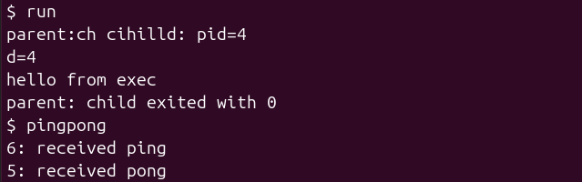

# Operating Systems: Laboratory Work No. 8

**The Same Calls Inside Your Own OS** (Track B: Build Your Own Small OS, xv6)

**Elaborated by:** Veacheslav Morari, FAF-243
**Verified by:** Patricia Reţman

---

## Contents

- [Introduction](#introduction)
- [1. run.c for xv6](#1-runc-for-xv6)
- [2. pingpong.c](#2-pingpongc)
- [3. Combined Output](#3-combined-output)
- [Conclusion](#conclusion)

---

## Introduction

In Laboratory Work No. 7 the three calls `fork`, `exec` and `wait` were used on Linux through `glibc`. The purpose of this laboratory work is to run the same calls inside xv6, the small operating system that is being extended throughout the course, and to see that they behave the same way. The work consists of two programs: `user/run.c`, which mirrors `run.c` from Lab 7, and `user/pingpong.c`, in which two processes exchange one byte through a pair of pipes. Both programs were added to the `UPROGS` list in the `Makefile` and compiled with the rest of xv6.

## 1. run.c for xv6

The program forks a child, prints its PID, calls `exec` on `echo`, and the parent waits for the child and prints its exit status. The structure matches `run.c` from Lab 7; only the API differs.

```c
#include "kernel/types.h"
#include "user/user.h"

int
main(void)
{
    int pid = fork();
    if (pid < 0) { fprintf(2, "fork failed\n"); exit(1); }

    if (pid == 0) {
        printf("child: pid=%d\n", getpid());
        char *args[] = {"echo", "hello from exec", 0};
        exec("echo", args);
        fprintf(2, "exec failed\n");
        exit(1);
    }

    printf("parent: child=%d\n", pid);
    int status;
    wait(&status);
    printf("parent: child exited with %d\n", status);
    exit(0);
}
```

After adding `$U/_run\` to `UPROGS` and rebuilding with `make clean && make qemu`, the program produced the output shown in Figure 1.1.

## 2. pingpong.c

Two processes exchange a single byte through a pair of pipes. The parent writes a byte into the first pipe; the child reads it, prints `<pid>: received ping`, writes the byte back through the second pipe and exits; the parent reads it, prints `<pid>: received pong`, and waits for the child.

```c
#include "kernel/types.h"
#include "user/user.h"

int
main(void)
{
    int p1[2], p2[2];
    pipe(p1); pipe(p2);

    int pid = fork();
    if (pid == 0) {
        char b;
        close(p1[1]); close(p2[0]);
        read(p1[0], &b, 1);
        printf("%d: received ping\n", getpid());
        write(p2[1], &b, 1);
        close(p1[0]); close(p2[1]);
        exit(0);
    }

    char b = 'x';
    close(p1[0]); close(p2[1]);
    write(p1[1], &b, 1);
    read(p2[0], &b, 1);
    printf("%d: received pong\n", getpid());
    close(p1[1]); close(p2[0]);
    wait(0);
    exit(0);
}
```

After adding `$U/_pingpong\` to `UPROGS` and rebuilding, `pingpong` ran in xv6 and printed the expected two lines, visible in Figure 1.1.

## 3. Combined Output

Figure 1.1 shows both programs running one after the other in a single xv6 session.



*Figure 1.1 — Running `run` and `pingpong` inside xv6 on 3 harts. The first line of `run`'s output shows the parent's `"parent: child=4"` and the child's `"child: pid=4"` interleaved character by character, because both processes run concurrently on different harts and write to the same terminal.*

### 3.1. Observations on run

The three calls `fork`, `exec` and `wait` behave the same as on Linux. The small differences are in the API: xv6 `exec` takes an *array* of arguments ending with `0`, not the variadic list of `execlp`; xv6 `wait(&status)` takes only one argument and waits for any child, there is no `waitpid`; error reporting goes to file descriptor 2 with `fprintf(2, ...)`, a library helper that wraps `write`. The lines after a successful `exec` are never executed, so the `fprintf(2, "exec failed\n")` line runs only when `exec` failed, which is also the Linux behaviour.

The most interesting observation comes from the first line of Figure 1.1. The parent prints `parent: child=4\n` and the child prints `child: pid=4\n`, but what actually appears on the terminal is `parent:ch cihilld: pid=4\nd=4`. The two strings are interleaved character by character. This happens because xv6 runs on three harts (`-smp 3`), the parent and the child are scheduled on different harts and both call `printf`, which eventually calls `write(1, ..., 1)` once per character. The kernel serves these writes in the order they arrive, and the hardware delivers them intermixed. On a single hart (`make qemu CPUS=1`) the same program prints two clean lines, because the two processes cannot execute at the same time.

### 3.2. Observations on pingpong

The child prints `received ping` first because the data flow decides the order: the child cannot continue past `read(p1[0], &b, 1)` until the parent has written one byte into `p1[1]`. No explicit synchronisation is needed; the pipe provides it.

One pipe is not enough. A pipe is unidirectional: `p[1]` is the writing end and `p[0]` is the reading end. To send a byte in both directions, two pipes are needed, one for each direction. The same rule as in Lab 7 applies here: every process closes the pipe ends it does not use, otherwise `read` would never return EOF and the other side would block forever.

## Conclusion

The three calls `fork`, `exec` and `wait` appear inside xv6 with the same meaning and almost the same signatures as on Linux. The `run` program is a line-for-line translation of its Linux counterpart, and it behaves the same, while also exposing the real concurrency of xv6: the interleaved first line of its output is direct evidence that the parent and the child are executing at the same time on different harts. The pingpong experiment showed that two processes can coordinate purely through pipes, without ever sharing memory: the kernel buffer is the only channel between them, and its EOF behaviour synchronises the two sides. The small operating system I am building this semester already supports all the pieces that drive the pipelines I type in bash every day.
