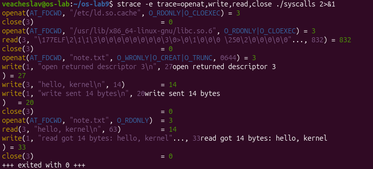
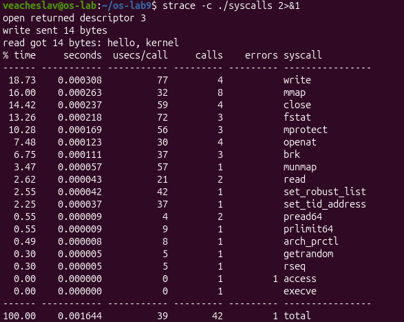

# Operating Systems: Laboratory Work No. 9

**Watching System Calls with strace** (Track A: The Real OS, from the Outside, Linux)

**Elaborated by:** Veacheslav Morari, FAF-243
**Verified by:** Patricia Reţman

---

## Contents

- [Introduction](#introduction)
- [1. See the calls of a real command](#1-see-the-calls-of-a-real-command)
- [2. A program that calls the kernel directly](#2-a-program-that-calls-the-kernel-directly)
- [3. Count one kind of call](#3-count-one-kind-of-call)
- [Conclusion](#conclusion)

---

## Introduction

In the lecture we crossed the door between a program and the kernel: the system call. The purpose of this laboratory work is to *watch* that door from the outside. The tool `strace` prints every system call a program makes. In the three parts of the lab we first look at the calls of a familiar command, then write a tiny C program that uses `open`, `write` and `read` directly, and finally count the kinds of system calls a program makes during one run. The work was done on Ubuntu 26.04 with `strace` from the `apt` repository.

## 1. See the calls of a real command

The first part looks at the calls that `ls -l` makes while listing the current directory. `strace` with the flag `-e trace=openat,read,write,close` limits the output to those four calls, which are enough to understand the pattern:

```
$ strace -f -e trace=openat,read,write,close ls -l | head -40
```

The output showed a burst of `openat`/`read`/`close` while `ls` loads its shared libraries (`libc.so.6`, `libselinux.so.1`, `libpcre2-8.so.0`), then opens `/proc/filesystems` and `/proc/self/maps`, reads coreutils locale files, and finally opens the directory `"."` itself. The listing is produced by a single `write`:

```
openat(AT_FDCWD, ".", O_RDONLY|O_NONBLOCK|O_CLOEXEC|O_DIRECTORY) = 3
close(3)
write(1, "total 0\n", 8)
```

### 1.1. Observations

`ls` prints to the screen with the `write` system call, on file descriptor **1**, the standard output. Even a small command like `ls -l` on an empty directory makes dozens of system calls: most of them are the dynamic loader fetching shared libraries, and only a few are the real work (opening the directory and writing the listing). This is a first glimpse of how much the kernel does for a single command.

## 2. A program that calls the kernel directly

The second part uses a small C program, `syscalls.c`, that reaches for the kernel without any library wrapper around the three main calls. It creates a file, writes a short message, closes it, opens it again, reads the message back and closes it. The complete source is in `syscalls.c`.

```c
int fd = open("note.txt", O_CREAT | O_WRONLY | O_TRUNC, 0644);
printf("open returned descriptor %d\n", fd);
ssize_t n = write(fd, msg, strlen(msg));
printf("write sent %zd bytes\n", n);
close(fd);

fd = open("note.txt", O_RDONLY);
char buf[64];
n = read(fd, buf, sizeof(buf) - 1);
buf[n] = '\0';
printf("read got %zd bytes: %s", n, buf);
close(fd);
```

Compiled with `gcc -Wall -Wextra -o syscalls syscalls.c` and run, the program produced the expected three lines:

```
open returned descriptor 3
write sent 14 bytes
read got 14 bytes: hello, kernel
```

The same run under `strace -e trace=openat,write,read,close ./syscalls` showed the calls hidden behind the C code. Figure 1.1 shows the output.



*Figure 1.1 — strace output for `syscalls`. The three calls we wrote (`openat`, `write`, `read`, `close`) appear after the loader has opened `libc.so.6`. The descriptor returned by every `openat` is 3.*

### 2.1. Observations

The descriptor returned by the first `openat` on `note.txt` is **3**, not 0, 1 or 2, because every new process is born with three open file descriptors already in place: 0 is the standard input (the keyboard, inherited from the shell), 1 is the standard output (the terminal), and 2 is the standard error (also the terminal). The kernel always gives a new open the smallest free number, and the first free number after 0, 1 and 2 is 3.

Figure 1.1 also shows the printf output interleaved with the strace lines. Each `printf` eventually becomes a `write(1, "...", n)` to standard output, which is why those lines appear under strace too. The library opens `libc.so.6` once at startup, which uses a few descriptor 3 slots that are closed immediately after reading the ELF header.

## 3. Count one kind of call

The third part measures how many calls of each kind a single run of the program makes. `strace -c` prints a summary table instead of the live output:

```
$ strace -c ./syscalls
```

The result for one run of `./syscalls` is shown in Figure 2.1.



*Figure 2.1 — `strace -c ./syscalls`: 42 system calls in total, grouped by kind. The counts (not the % time, which varies between runs) are deterministic for this program.*

### 3.1. Observations

The program makes **42 system calls in total**, far more than the three I wrote by hand. Most of them belong to the setup phase: 8 `mmap` calls and 3 `brk` calls grow the address space and map libc into memory; 3 `mprotect` calls set the right permissions on those regions; 3 `fstat` calls look at libc. Among my calls, `openat` appears 4 times (the loader's two opens of `/etc/ld.so.cache` and `libc.so.6`, plus my two opens of `note.txt`), `close` appears 4 times for the same reason, `read` appears twice (one for libc, one for `note.txt`), and `write` appears 4 times (one for the data in `note.txt` and three `write`s produced by the three `printf` calls).

The `-c` flag of `strace` is useful when the question is *how many* of a given call a program makes rather than *what order*. Running the same command twice gives the same counts but slightly different timings.

## Conclusion

Watching a program from the outside with `strace` turns the system call from an abstract idea into a concrete event: every line of the output is a visible crossing of the user–kernel boundary. The experiments showed that even a short program spends most of its calls on setup (loader, memory mapping) and only a few on real work, that file descriptors are small integers allocated by the kernel in the smallest-free-number order (which is why the first `open` returned 3), and that counting calls with `strace -c` is a quick way to compare the behaviour of programs. The same idea — print every system call a process makes — will be built from scratch in Lab 10, where `strace` is replaced by a new system call added to xv6.
